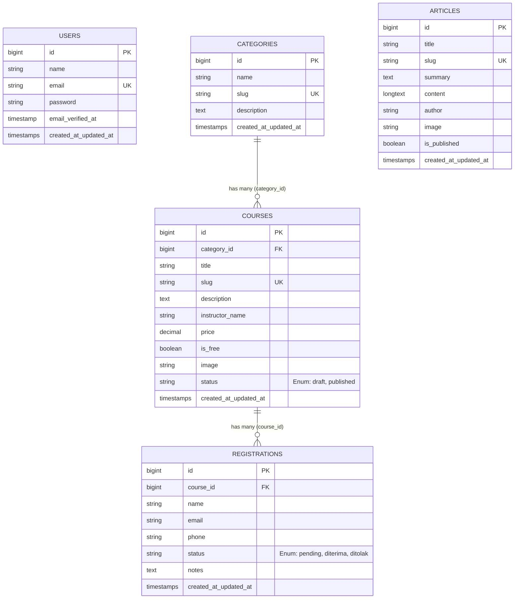

# DOKUMEN ANALISIS DAN PERANCANGAN SISTEM
## WEBSITE KELAS ONLINE SEDERHANA (EDUTECH)

**Disusun untuk**: Technical Test Magang - Web Developer  
**Kandidat**: Fadino  
**Tanggal**: November 2026  

---

## 1. PENDAHULUAN

Sistem Website Kelas Online Sederhana (**EduTech**) dirancang untuk memfasilitasi dua peran pengguna utama:
1. **Pengunjung (Calon Peserta)**: Mengakses informasi kelas pelatihan teknologi, menyaring kelas berdasarkan kategori, mencari instruktur/topik tertentu, membaca artikel/blog edukatif, dan mendaftarkan diri secara daring.
2. **Administrator**: Mengelola siklus hidup data kelas (Draft/Published), mengelola kategori, meninjau dan memperbarui status pendaftar (Pending/Diterima/Ditolak), mengunduh laporan pendaftar (CSV/Excel), serta mengelola publikasi artikel.

---

## 2. DAFTAR KEBUTUHAN FUNGSIONAL (FUNCTIONAL REQUIREMENTS)

| Kode | Modul | Kebutuhan Fungsional | Deskripsi |
|---|---|---|---|
| **FR-01** | Landing Page | Tampilan Beranda & Hero Section | Menampilkan banner pengenalan lembaga, statistik, keunggulan program, dan kontak resmi. |
| **FR-02** | Landing Page | Pencarian & Filter Kelas | Pengunjung dapat mencari kelas berdasarkan kata kunci judul/instruktur serta memfilter berdasarkan kategori dan tipe biaya (gratis/berbayar). |
| **FR-03** | Landing Page | Detail Kelas | Menampilkan informasi lengkap kelas (judul, deskripsi, harga, fasilitas, instruktur, dan rekomendasi kelas sejenis). |
| **FR-04** | Pendaftaran | Form Registrasi Online | Pengunjung dapat mengisi nama, email, nomor telepon/WhatsApp, dan catatan minat. |
| **FR-05** | Pendaftaran | Validasi Anti-Duplikasi Email | Sistem mencegah pendaftaran ganda apabila email yang sama mencoba mendaftar pada kelas yang sama. |
| **FR-06** | Autentikasi | Login & Logout Admin | Pengelola harus melakukan otentikasi menggunakan email dan password untuk masuk ke dashboard. |
| **FR-07** | Dashboard | Ringkasan Statistik | Menampilkan ringkasan total kelas (published/draft), total pendaftar, dan 5 pendaftar terbaru. |
| **FR-08** | Master Data | CRUD Kategori | Admin dapat menambah, melihat, memperbarui, dan menghapus kategori kelas. |
| **FR-09** | Master Data | CRUD Kelas Online | Admin dapat menambah, mengubah, mengunggah thumbnail gambar, menghapus, serta mengatur status (Draft/Published) kelas. |
| **FR-10** | Kelas | Filter Visibilitas Publik | Sistem hanya menampilkan kelas berstatus `Published` di halaman publik pengunjung. |
| **FR-11** | Manajemen Pendaftar | Tinjau & Ubah Status Pendaftar | Admin dapat melihat daftar pendaftar per kelas dan mengubah statusnya menjadi `Pending`, `Diterima`, atau `Ditolak`. |
| **FR-12** | Fitur Bonus | Ekspor CSV / Excel | Admin dapat mengekspor rekapitulasi data pendaftar ke file format CSV/Excel secara langsung. |
| **FR-13** | Fitur Bonus | Blog & Artikel | Pengunjung dapat membaca tips teknologi, dan Admin dapat mengelola artikel publikasi. |

---

## 3. USE CASE DIAGRAM

Di bawah ini adalah diagram Use Case perancangan interaksi antara aktor (Pengunjung dan Admin) dengan sistem website:

```mermaid
flowchart LR
    subgraph Aktor
        Guest["Pengunjung (Calon Peserta)"]
        Admin["Administrator (Pengelola)"]
    end

    subgraph Sistem Kelas Online (EduTech)
        UC1(["Lihat Beranda & Kontak"])
        UC2(["Cari & Filter Kelas"])
        UC3(["Lihat Detail Kelas"])
        UC4(["Mendaftar Kelas Online"])
        UC5(["Baca Artikel / Blog"])
        
        UC6(["Login / Logout Admin"])
        UC7(["Lihat Dashboard & 5 Pendaftar Terbaru"])
        UC8(["Kelola Kategori (CRUD)"])
        UC9(["Kelola Kelas Online (CRUD)"])
        UC10(["Ubah Status Pendaftar (Pending/Diterima/Ditolak)"])
        UC11(["Ekspor Data Pendaftar (CSV/Excel)"])
        UC12(["Kelola Artikel Blog (CRUD)"])
    end

    Guest --> UC1
    Guest --> UC2
    Guest --> UC3
    Guest --> UC4
    Guest --> UC5

    Admin --> UC6
    Admin --> UC7
    Admin --> UC8
    Admin --> UC9
    Admin --> UC10
    Admin --> UC11
    Admin --> UC12
```

---

## 4. ENTITY RELATIONSHIP DIAGRAM (ERD)

Struktur relasi basis data menggunakan prinsip Eloquent ORM:
- **1 Kategori** memiliki banyak (**hasMany**) **Kelas**.
- **1 Kelas** dimiliki oleh (**belongsTo**) **1 Kategori**.
- **1 Kelas** memiliki banyak (**hasMany**) **Pendaftar**.
- **1 Pendaftar** terdaftar pada (**belongsTo**) **1 Kelas**.
- Terdapat unique constraint pada kombinasi `(course_id, email)` di tabel `registrations`.



---

## 5. SKEMA TABEL DAN ATRIBUT

### A. Tabel `categories`
| Kolom | Tipe Data | Keterangan |
|---|---|---|
| `id` | BIGINT UNSIGNED | Primary Key, Auto Increment |
| `name` | VARCHAR(255) | Nama kategori (contoh: Web Development) |
| `slug` | VARCHAR(255) | Slug URL unik untuk routing dan filter |
| `description` | TEXT (Nullable) | Penjelasan singkat kategori |
| `created_at`, `updated_at` | TIMESTAMP | Waktu pencatatan record |

### B. Tabel `courses`
| Kolom | Tipe Data | Keterangan |
|---|---|---|
| `id` | BIGINT UNSIGNED | Primary Key, Auto Increment |
| `category_id` | BIGINT UNSIGNED | Foreign Key ke tabel `categories.id` |
| `title` | VARCHAR(255) | Judul kelas online |
| `slug` | VARCHAR(255) | Slug URL unik |
| `description` | TEXT | Deskripsi lengkap silabus dan materi |
| `instructor_name` | VARCHAR(255) | Nama pengajar / mentor ahli |
| `price` | DECIMAL(12,2) | Biaya kelas (default: 0) |
| `is_free` | BOOLEAN | Penanda kelas gratis |
| `image` | VARCHAR(255) (Nullable)| Path thumbnail di Storage Laravel |
| `status` | VARCHAR(50) | Status publikasi via Enum (`draft`, `published`) |
| `created_at`, `updated_at` | TIMESTAMP | Waktu pembuatan & modifikasi |

### C. Tabel `registrations`
| Kolom | Tipe Data | Keterangan |
|---|---|---|
| `id` | BIGINT UNSIGNED | Primary Key, Auto Increment |
| `course_id` | BIGINT UNSIGNED | Foreign Key ke tabel `courses.id` |
| `name` | VARCHAR(255) | Nama lengkap pendaftar |
| `email` | VARCHAR(255) | Email pendaftar (Unique per course) |
| `phone` | VARCHAR(50) | Nomor telepon / WhatsApp aktif |
| `status` | VARCHAR(50) | Status via Enum (`pending`, `diterima`, `ditolak`) |
| `notes` | TEXT (Nullable) | Catatan / motivasi calon peserta |
| `created_at`, `updated_at` | TIMESTAMP | Waktu pendaftaran |

---

## 6. KESIMPULAN

Rancangan sistem ini telah diimplementasikan secara utuh pada framework **Laravel 13** dengan memenuhi seluruh aspek penilaian teknis:
1. Integritas data terjamin melalui foreign key relasi Eloquent dan unique composite constraint.
2. Validasi input menggunakan Laravel Form Request dengan pesan ramah pengguna.
3. Kerapian kode memanfaatkan fitur modern PHP seperti Backed Enums untuk status kelas dan pendaftar.
4. Dilengkapi automated testing untuk menjamin keandalan alur bisnis sistem saat pengujian dan demonstrasi wawancara teknis.
